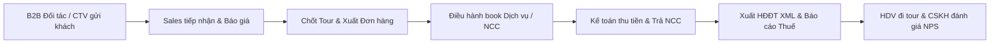

# 🌍 HaHa Eco Travel - Hệ Thống ERP & CRM Lữ Hành Thông Minh

[](https://vercel.com)
[](https://developer.mozilla.org/en-US/docs/Web/Progressive_web_apps)
[](https://firebase.google.com)
[](https://gdt.gov.vn)
[](LICENSE)

> **Hệ sinh thái Quản trị & Vận hành Doanh nghiệp Du lịch Lữ hành toàn diện.**  
> Thiết kế chuẩn hóa theo nghiệp vụ lữ hành quốc tế và nội địa, đáp ứng 100% quy định pháp luật kế toán & cơ quan Thuế Việt Nam, hỗ trợ làm việc thời gian thực đa nền tảng (Web, Mobile App PWA, Tablet).

---

## 📑 Mục Lục
1. [Giới Thiệu Chung](#-giới-thiệu-chung)
2. [Cấu Trúc 11 Phân Hệ Chức Năng](#-cấu-trúc-11-phân-hệ-chức-năng)
3. [Tuân Thủ Pháp Luật & Thuế Việt Nam](#-tuân-thủ-pháp-luật--kế-toán-thuế-việt-nam)
4. [Kiến Trúc Kỹ Thuật & Đồng Bộ Realtime](#-kiến-trúc-kỹ-thuật--công-nghệ)
5. [Tài Khoản Thử Nghiệm Phân Quyền](#-tài-khoản-thử-nghiệm-phân-quyền)
6. [Hướng Dẫn Triển Khai (Deployment)](#-hướng-dẫn-triển-khai-lên-web--cloud)
   - [Cách 1: Đưa lên Vercel (Khuyên dùng)](#cách-1-đưa-lên-vercel-miễn-phí-tự-động-sync-github)
   - [Cách 2: Chạy trực tiếp trên máy cục bộ](#cách-2-chạy-cục-bộ-trên-máy-tính)
7. [Cấu Hình Đồng Bộ Thời Gian Thực (Google Firebase)](#-cấu-hình-đồng-bộ-thời-gian-thực-google-firebase)
8. [Cài Đặt App Trên Điện Thoại (PWA)](#-cài-đặt-app-trên-điện-thoại-ios--android)

---

## 🌟 Giới Thiệu Chung

**HaHa Eco Travel ERP & CRM** là giải pháp số hóa toàn diện quy trình lữ hành khép kín:


- **Không đứt gãy dữ liệu:** Dữ liệu được luân chuyển mượt mà giữa các phòng ban.
- **Tương thích hoàn hảo:** Hoạt động trơn tru trên mọi thiết bị và trình duyệt (Chrome, Safari, Edge, Firefox, Cốc Cốc).
- **Phân quyền độc lập (RBAC):** Cổng đăng nhập thông minh phân tách giao diện theo từng phòng ban, đảm bảo an toàn bí mật kinh doanh.

---

## 🏛 Cấu Trúc 11 Phân Hệ Chức Năng

| STT | Phân Hệ | Chức Năng Cốt Lõi |
|---|---|---|
| 1 | **Ban Lãnh Đạo (Executive)** | Dashboard báo cáo doanh thu, dòng tiền, tỷ suất lợi nhuận, biểu đồ tăng trưởng và cảnh báo rủi ro tức thì. |
| 2 | **Đối Tác & CTV (B2B Portal)** | Giao diện riêng biệt cho Đại lý/Cộng tác viên: Gửi khách, đăng ký giữ chỗ tour, theo dõi hoa hồng minh bạch, tải tài liệu bán hàng. |
| 3 | **Kinh Doanh & Sales** | Phễu khách hàng tiềm năng (Leads Pipeline), lập báo giá tour tự động, xuất hợp đồng du lịch, tính giá net/giá bán, chốt tour 1-click. |
| 4 | **Điều Hành Tour (Operations)** | Quản lý nhà cung cấp (Khách sạn, Xe buýt, Nhà hàng, Vé máy bay, Thuyền bè...), điều phối HDV, quản lý phát sinh tour. |
| 5 | **Tài Chính & Kế Toán** | Theo dõi công nợ khách hàng (Phải thu), công nợ nhà cung cấp (Phải trả), xuất hóa đơn điện tử XML, sổ cái, lưu chuyển tiền tệ. |
| 6 | **Marketing Lữ Hành** | Đo lường hiệu quả chiến dịch (Campaigns), chi phí chuyển đổi (CAC), tối ưu hóa nguồn khách (Google, Facebook, Zalo, Đối tác). |
| 7 | **Chăm Sóc Khách Hàng (CSKH)** | Quản lý phản hồi sau tour, đánh giá chất lượng dịch vụ (NPS/CSAT), giải quyết khiếu nại, chăm sóc khách hàng VIP & ngày sinh. |
| 8 | **Hướng Dẫn Viên (Tour Guide)** | Xem nhật ký tour điện tử, danh sách đoàn, quản lý điểm danh, báo cáo chi tiêu phát sinh trên tour bằng ảnh hóa đơn. |
| 9 | **Quản Trị Hệ Thống (Admin)** | Quản lý người dùng, phân cấp quyền hạn chi tiết, thiết lập danh mục hệ thống, cấu hình Cloud Sync. |
| 10 | **Kho Tài Liệu & Mẫu Hợp Đồng** | Lưu trữ hồ sơ pháp lý, biểu mẫu điều hành, chương trình tour mẫu, giấy phép lữ hành quốc tế/nội địa. |
| 11 | **Báo Cáo Phân Tích Chuyên Sâu** | Báo cáo lợi nhuận gộp theo từng tuyến tour, phân tích hiệu suất làm việc của Sales và Điều hành. |

---

## ⚖ Tuân Thủ Pháp Luật & Kế Toán Thuế Việt Nam

Hệ thống được thiết kế chuẩn mực đáp ứng đầy đủ các quy định pháp lý hiện hành của Bộ Tài chính và Tổng cục Thuế Việt Nam:

1. **Thuế GTGT Lữ hành (Thông tư 219/2013/TT-BTC - Điều 15):**  
   - Tự động bóc tách doanh thu dịch vụ lữ hành trọn gói: Doanh thu tính thuế GTGT = *Tổng giá bán tour - Các chi phí mua ngoài phục vụ khách* (tiền ăn, ở, vé máy bay, vé tham quan...).  
   - Tránh việc tính trùng thuế GTGT, đảm bảo tối ưu hóa dòng tiền hợp pháp cho doanh nghiệp du lịch.
2. **Hóa Đơn Điện Tử XML Chuẩn Tổng Cục Thuế (Nghị định 123/2020/NĐ-CP & Thông tư 78/2021/TT-BTC):**  
   - Tạo và xuất dữ liệu hóa đơn điện tử cấu trúc XML đầy đủ mã số thuế, ký hiệu mẫu số, ký hiệu hóa đơn, mã CQT để sẵn sàng truyền nhận trực tiếp với cơ quan thuế hoặc các nhà cấp giải pháp VNPT, Viettel, MISA.
3. **Thuế Thu Nhập Cá Nhân Đại Lý / CTV (Thông tư 111/2013/TT-BTC):**  
   - Tự động trích khấu trừ thuế TNCN 10% đối với các khoản chi trả hoa hồng môi giới/đại lý từ 2.000.000 VNĐ/lần trở lên.
4. **Hệ Thống Tài Khoản Kế Toán (Thông tư 200/2014/TT-BTC & Thông tư 133/2016/TT-BTC):**  
   - Chuẩn hóa mã tài khoản hạch toán: `TK 131` (Phải thu khách hàng), `TK 331` (Phải trả người bán), `TK 511` (Doanh thu), `TK 632` (Giá vốn dịch vụ lữ hành), `TK 111/112` (Tiền mặt/Tiền gửi ngân hàng).

---

## 💻 Kiến Trúc Kỹ Thuật & Công Nghệ

- **Frontend Core:** HTML5, Modern ES6+ JavaScript, Tailwind CSS, Font Awesome 6 Pro, Animate.css.
- **Biểu đồ & Báo cáo:** Chart.js hỗ trợ trực quan hóa dữ liệu kinh doanh.
- **Offline & PWA:** Service Worker (`sw.js`) và `manifest.json` cho phép truy cập nhanh và sử dụng ngoại tuyến cơ bản.
- **Bộ nhớ lưu trữ:**
  - *Local Persistence:* Web Storage API (`localStorage`) kết hợp cache bộ nhớ đảm bảo tốc độ phản hồi < 0.1s.
  - *Cloud Realtime Engine:* Tích hợp Firebase Realtime Database qua giao thức SSE (Server-Sent Events) và REST API, đồng bộ hai chiều (Bi-directional Instant Sync) mà không phụ thuộc vào thư viện bên thứ ba cồng kềnh.
- **Bảo mật:**
  - Phòng chống XSS bằng cơ chế Escape HTML tự động.
  - Phân vùng dữ liệu theo Token phiên đăng nhập và Role người dùng.

---

## 🔑 Tài Khoản Thử Nghiệm Phân Quyền

Khi truy cập cổng đăng nhập, bạn có thể chọn nhanh hoặc nhập tài khoản tương ứng:

| Bộ Phận | Tên Đăng Nhập | Mật Khẩu | Quyền Hạn |
|---|---|---|---|
| **Tổng Giám Đốc** | `admin` | `admin123` | Toàn quyền kiểm soát và điều hành toàn bộ hệ thống |
| **Kế Toán Trưởng** | `ketoan` | `ketoan123` | Quản lý thu chi, công nợ, xuất hóa đơn thuế, báo cáo tài chính |
| **Trưởng Phòng Sales** | `sales` | `sales123` | Quản lý Leads, báo giá, hợp đồng, xuất đơn tour |
| **Điều Hành Tour** | `dieuhanh` | `dieuhanh123` | Quản lý booking NCC, xe cộ, khách sạn, phân công HDV |
| **Đại Lý / CTV B2B** | `ctv` | `ctv123` | Gửi khách, xem tiến độ tour, quản lý ví hoa hồng cá nhân |
| **Hướng Dẫn Viên** | `hdv` | `hdv123` | Xem lịch dẫn tour, danh sách khách, báo cáo chi tiêu tour |

---

## 🚀 Hướng Dẫn Triển Khai Lên Web & Cloud

### Cách 1: Đưa Lên Vercel (Miễn phí, Tự động Sync GitHub)

1. **Đăng nhập Vercel:** Truy cập [vercel.com](https://vercel.com) và đăng nhập bằng tài khoản GitHub của bạn.
2. **Import Repository:**
   - Bấm **Add New...** -> **Project**.
   - Chọn kho lưu trữ GitHub của dự án (ví dụ: `your-username/haha-operating-system`).
3. **Deploy:**
   - Framework Preset: Chọn **Other**.
   - Root Directory: `./`
   - Bấm **Deploy**.
4. **Kết quả:** Sau 15 - 30 giây, Vercel sẽ cấp cho bạn tên miền miễn phí dạng `https://ten-du-an.vercel.app` có sẵn SSL (HTTPS). Mọi lần bạn push code lên GitHub, Vercel sẽ tự động cập nhật web mới nhất!

### Cách 2: Chạy Cục Bộ Trên Máy Tính

Không cần cài đặt phức tạp, bạn chỉ cần:
- Nhấp đúp chuột trực tiếp vào tệp `index.html` để mở trên trình duyệt (Edge, Chrome, Cốc Cốc, Safari).
- Hoặc sử dụng tiện ích mở rộng **Live Server** trên VS Code.
- Hoặc chạy lệnh Python nếu có: `python -m http.server 8080`.

---

## 🔄 Cấu Hình Đồng Bộ Thời Gian Thực (Google Firebase)

Để dữ liệu tự động đồng bộ ngay lập tức giữa điện thoại của giám đốc, máy tính của kế toán và điện thoại của đại lý ngoài thị trường:

1. Truy cập [Firebase Console](https://console.firebase.google.com/) và tạo một dự án miễn phí (gói Spark vĩnh viễn không mất phí).
2. Vào mục **Build** -> **Realtime Database** -> Bấm **Create Database** (chọn khu vực Singapore hoặc US).
3. Tại tab **Rules**, đặt quyền đọc ghi:
   ```json
   {
     "rules": {
       ".read": true,
       ".write": true
     }
   }
   ```
4. Copy đường dẫn cơ sở dữ liệu (ví dụ: `https://haha-travel-crm-default-rtdb.asia-southeast1.firebasedatabase.app/`).
5. Đăng nhập vào phần mềm HaHa Travel với quyền **Admin** -> Vào mục **Cấu hình Hệ Thống** -> Dán URL Firebase -> Bấm **Lưu & Bật Đồng Bộ Realtime**.
6. Hệ sinh thái đã sẵn sàng hoạt động tức thì trên hàng trăm máy cùng lúc!

---

## 📱 Cài Đặt App Trên Điện Thoại (iOS & Android)

Hệ thống đã được đóng gói chuẩn **PWA (Progressive Web App)**:

- **Trên iPhone / iPad (Safari):**
  1. Mở link web Vercel bằng trình duyệt Safari.
  2. Bấm vào nút **Chia sẻ (Share)** hình ô vuông có mũi tên trỏ lên ở thanh công cụ dưới.
  3. Chọn **Thêm vào MH chính (Add to Home Screen)**.
  4. Ứng dụng sẽ xuất hiện với biểu tượng logo HaHa Eco Travel đẹp mắt trên màn hình chính như một ứng dụng cài từ App Store.

- **Trên Android (Chrome / Cốc Cốc / Samsung Internet):**
  1. Mở link web trên trình duyệt Chrome.
  2. Hệ thống sẽ tự động hiện thanh thông báo *"Cài đặt HaHa Travel"*.
  3. Bấm **Cài đặt (Install)** hoặc bấm vào menu 3 chấm góc phải trên -> chọn **Thêm vào màn hình chính**.

---

## 📄 Bản Quyền & Giấy Phép

Phát triển và phân phối dưới giấy phép **[MIT License](LICENSE)**.  
Bản quyền thuộc về **HaHa Eco Travel Vietnam**. Toàn bộ mã nguồn sẵn sàng mở rộng, tùy biến và tích hợp hệ sinh thái API du lịch.
